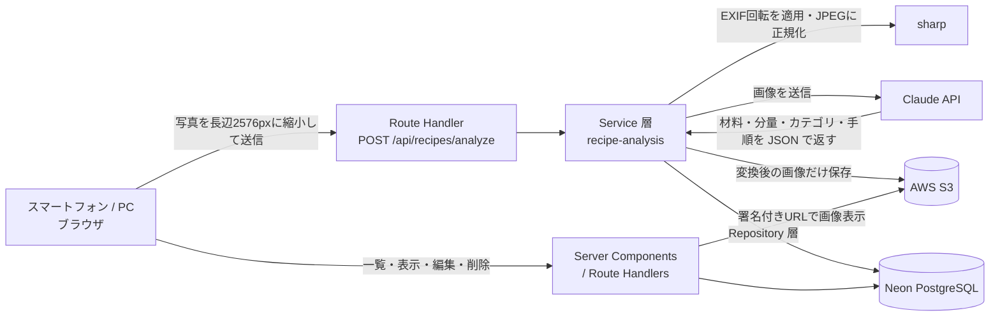

# Cooking Instructor（recipe-app）

**料理本のレシピを写真に撮るだけで、材料と作り方を読み取って保存できる Web アプリ**です。

写真を Claude（Anthropic の画像認識モデル）で解析し、材料を「野菜 / 調味料 / その他」に自動で分類して表示します。保存したレシピは一覧から見返したり、読み取りミスを直したりできます。

**▶ アプリを開く: https://recipe-app-nu-liart.vercel.app**（Google アカウントでログイン）

> 将来的にはモバイルアプリとして提供することを目指しており、この Web 版は中核機能（撮影 → 読み取り → 分類 → 保存）の検証を兼ねています。

---

## 目次

1. [できること](#できること)
2. [スマートフォンで使う方法](#スマートフォンで使う方法)
3. [技術スタック](#技術スタック)
4. [アーキテクチャ](#アーキテクチャ)
5. [設計で工夫した点](#設計で工夫した点)
6. [開発の進め方](#開発の進め方)
7. [ローカルで動かす](#ローカルで動かす)
8. [ディレクトリ構成](#ディレクトリ構成)
9. [設計ドキュメント](#設計ドキュメント)
10. [今後の予定](#今後の予定)

---

## できること

| 機能                  | 内容                                                                                                     |
| --------------------- | -------------------------------------------------------------------------------------------------------- |
| **Google でログイン** | アカウント登録は不要。レシピはユーザーごとに分かれて保存され、他の人のレシピは見えません                 |
| **写真から読み取り**  | 料理本のページを撮影（またはアルバムから選択）すると、タイトル・何人分・材料と分量・作り方を読み取ります |
| **材料の自動分類**    | 材料を「野菜」「調味料」「その他」の3つに分けて表示します。買い物や下ごしらえの段取りがしやすくなります  |
| **確認画面**          | 読み取り直後に結果を確認できます。読み取った時点で保存済みなので、画面を閉じても結果は失われません       |
| **レシピ一覧**        | 保存したレシピが写真付きのカードで並びます。一覧から削除もできます（写真も一緒に消えます）               |
| **編集**              | 材料名・分量・カテゴリ・作り方の手順を直せます。行の追加・削除もできます                                 |

### 画面の流れ

```
ログイン ─▶ レシピ一覧 ─▶ 写真を撮る / 選ぶ ─▶ 読み取り中（10〜20秒ほど）─▶ 確認画面
                │                                                       │
                └──────────▶ レシピを見る ◀──────────────────────────────┘
                                 │
                                 └─▶ 編集
```

---

## スマートフォンで使う方法

アプリのインストールは不要です。**スマートフォンのブラウザで URL を開くだけ**で使えます。画面はスマートフォンの縦持ちを基準に作っています。

### 1. ブラウザでアプリを開く

| 端末    | 使うブラウザ |
| ------- | ------------ |
| iPhone  | Safari       |
| Android | Chrome       |

下の URL を開きます（PC で見ている場合は、この URL をスマートフォンに送ってください）。

```
https://recipe-app-nu-liart.vercel.app
```

### 2. Google アカウントでログインする

「Googleでログイン」をタップし、使う Google アカウントを選びます。ログインするとレシピ一覧（初回は空）が表示されます。

> **⚠️ ログインできない場合:** 現在は個人開発のため、Google ログインを**登録済みのアカウントだけ**に限定しています。試してみたい方は、お使いの Google アカウント（Gmail アドレス）を開発者までお知らせください。

### 3. ホーム画面に追加する（任意・おすすめ）

ホーム画面にアイコンを置いておくと、アプリのようにワンタップで開けます。

**iPhone（Safari）**

1. 画面下の **共有ボタン**（□ に ↑ のアイコン）をタップ
2. メニューを下にスクロールして **「ホーム画面に追加」** をタップ
3. 右上の **「追加」** をタップ

**Android（Chrome）**

1. 画面右上の **︙（メニュー）** をタップ
2. **「ホーム画面に追加」** をタップ（表示が「アプリをインストール」の場合もあります）
3. **「追加」** をタップ

### 4. レシピを撮影して読み取る

1. レシピ一覧の右下にある **「＋」ボタン** をタップ（レシピが0件のときは **「写真を撮る」** ボタン）
2. **「カメラで撮る」** を選ぶとカメラが直接起動します。撮影済みの写真を使う場合は **「写真を選ぶ」** を選びます
3. 撮影 / 選択すると読み取りが始まります（**10〜20秒ほど**。読み取り中はそのままお待ちください）
4. 読み取りが終わると **確認画面** が開きます。内容に誤りがあれば「編集する」から直せます

### きれいに読み取るコツ

- 1枚に **1つのレシピ** が収まるように撮る（見開き全体より、レシピのあるページだけのほうが精度が上がります）
- 真上から、影や反射が入らないように撮る
- 材料欄の小さい文字が読める距離まで近づく

### うまくいかないとき

| 症状                             | 対処                                                                                                                                                                                  |
| -------------------------------- | ------------------------------------------------------------------------------------------------------------------------------------------------------------------------------------- |
| 「この写真は使えません」と出る   | JPEG / PNG 以外（iPhone の **HEIC 形式** など）には未対応です。「カメラで撮る」から撮影するか、iPhone の **設定 → カメラ → フォーマット → 「互換性優先」** にしてから撮影してください |
| カメラが起動しない               | ブラウザにカメラの使用を許可しているか確認してください（iPhone: 設定 → Safari → カメラ）                                                                                              |
| ログイン画面に戻される           | 上記「ログインできない場合」をご覧ください                                                                                                                                            |
| 読み取り結果が一部まちがっている | 確認画面またはレシピ画面の「編集」から直せます                                                                                                                                        |

---

## 技術スタック

| 分類           | 採用技術                                                |
| -------------- | ------------------------------------------------------- |
| フレームワーク | **Next.js 16**（App Router）/ React 19 / TypeScript     |
| スタイリング   | Tailwind CSS v4（デザイントークンを `@theme` で定義）   |
| API            | Next.js Route Handlers                                  |
| 認証           | Auth.js（NextAuth v5）+ Google OAuth / JWT セッション   |
| DB             | **Neon**（サーバーレス PostgreSQL）+ **Prisma 7**       |
| 画像認識       | **Anthropic Claude API**（vision + structured outputs） |
| 画像処理       | sharp（サーバー）/ Canvas（クライアント）               |
| ストレージ     | **AWS S3**（非公開バケット + 署名付き URL）             |
| バリデーション | Zod                                                     |
| テスト         | Vitest + Testing Library（テストファイル39本）          |
| 品質管理       | ESLint（warning 0 を強制）/ Prettier / `tsc --noEmit`   |
| ホスティング   | Vercel（`main` への push で本番に自動デプロイ）         |

選定理由は [`.kiro/steering/tech-stack.md`](.kiro/steering/tech-stack.md) にまとめています。

---

## アーキテクチャ



**レイヤー構成**（[`.kiro/steering/architecture.md`](.kiro/steering/architecture.md)）

```
app/（画面・Route Handlers） → lib/services/（業務ロジック） → lib/repositories/（DB アクセス）
                                                          └→ lib/clients/（Claude・S3 などの外部サービス）
```

**API**

| メソッド | パス                   | 役割                               |
| -------- | ---------------------- | ---------------------------------- |
| `POST`   | `/api/recipes/analyze` | 写真を解析し、レシピとして保存する |
| `PATCH`  | `/api/recipes/[id]`    | タイトルを変更する                 |
| `PUT`    | `/api/recipes/[id]`    | 材料と手順をまとめて置き換える     |
| `DELETE` | `/api/recipes/[id]`    | レシピと S3 上の画像を削除する     |

すべて**ログイン中のユーザー本人のレシピにだけ**作用します（他人のレシピの ID を指定しても 404 を返す）。

---

## 設計で工夫した点

### 画像を「クライアントとサーバーの両方」で正規化する

スマートフォンの写真は 5〜10MB になることがあり、そのまま送るとアップロードが遅く、Claude API の上限（1画像10MB）にもかかります。そこで**ブラウザ側（Canvas）で長辺2576px・JPEG品質85に縮めてから送信**し、サーバー側（sharp）でも同じ値で正規化しています。2576px は採用モデルの高解像度ティアの上限に合わせた値です。

### スマホ写真が横倒しにならないように

スマートフォンの写真は「向き」を EXIF メタデータで持っていますが、**Claude は画像のメタデータを読みません**。sharp で `.rotate()` を呼んで回転を画素に焼き込んでから送ることで、横倒しの写真でも正しく読み取れるようにしています。

### 解析結果は「確認画面を出す前に」保存する

解析には API コストと10〜20秒の待ち時間がかかります。確認画面で保存ボタンを押す方式だと、ユーザーが画面を閉じた瞬間に結果が失われるため、**読み取り直後に保存してから確認画面を出す**設計にしました。

### 構造化出力で JSON の崩れを防ぐ

Claude の **structured outputs** を使い、材料・分量・カテゴリ（`VEGETABLE` / `SEASONING` / `OTHER`）・手順を決まった形の JSON で受け取っています。プロンプトで「JSON で返して」と頼む方式と違い、パースに失敗する経路がありません。

### 画像は非公開、表示のたびに署名付き URL を発行

S3 のバケットは公開していません。DB には URL ではなく**オブジェクトキーだけ**を保存し、表示のたびに有効期限1時間の署名付き URL を発行します。元画像は保存せず、縮小後の画像だけを残します（容量とプライバシーのため）。

### 分量は文字列で持つ

「200g」「大さじ1」「少々」「適量」のように、料理の分量は数値と単位に分けられないものが多いため、分量はあえて文字列のまま保存しています。

### サーバーレスの制約に合わせた設計

- 解析は**同期処理**（ジョブキューを入れない）。Vercel の実行時間上限に対して十分短いため、構成を単純に保ちました。保険として `maxDuration = 60` と SDK のタイムアウトを設定しています
- 画像の送信は Server Actions ではなく **Route Handler** を使用（Server Actions は body の既定上限が1MBのため）
- DB の接続 URL を**プール接続（実行用）と直接接続（マイグレーション用）の2本**に分け、サーバーレス関数でのコネクション枯渇を防いでいます

---

## 開発の進め方

このアプリは **Claude Code と一緒に**、仕様駆動（[Kiro](kiro-personal-app-guide.md) 方式）で開発しました。

1. **要件定義**（[`REQUIREMENTS.md`](REQUIREMENTS.md)）と**画面設計**（[`UI_DESIGN.md`](UI_DESIGN.md)）を先に固める
2. 機能を**フェーズ**に分け、フェーズごとに `.kiro/specs/<機能>/` に `requirements.md` / `design.md` / `tasks.md` を作る
3. フェーズを「1文で何をしたか言える」粒度の**段階**に分け、**1段階 = 1コミット**で実装する
4. 各コミットの前に `format` / `lint` / `tsc` / `test` / `build` をすべて通す
5. 実装中に分かったこと・ハマった点は `tasks.md` の「実施時の記録」と `design.md` の「落とし穴の一覧」に残す

設計書の事実の記述には **「✅ 実測」「📄 出典」「⚠️ 未検証」** のラベルを付け、記憶や推測で書いた内容が実装に紛れ込まないようにしています（[`.kiro/README.md`](.kiro/README.md)）。

| Phase | 機能              | 内容                                         | 状態                           |
| ----- | ----------------- | -------------------------------------------- | ------------------------------ |
| 0     | `foundation`      | プロジェクト基盤（DB・lint・テスト環境）     | 完了                           |
| 1     | `user-auth`       | Google ログイン                              | 完了                           |
| 2     | `recipe-analysis` | 写真のアップロードと Claude による解析・保存 | 完了                           |
| 3     | `recipe-view`     | レシピ表示・確認画面                         | 完了                           |
| 4     | `recipe-list`     | レシピ一覧・削除                             | 完了                           |
| 5     | `recipe-edit`     | 材料・手順の編集                             | 実装済み（実機での最終確認中） |

ビジュアルデザインは Claude Design で作成し、デザイントークンとして `app/globals.css` に取り込んでいます（[`Design_引き継ぎ資料/`](Design_引き継ぎ資料/)）。

---

## ローカルで動かす

### 必要なもの

- Node.js 24 系
- 外部サービスのアカウントとキー: Google OAuth クライアント / Neon / Anthropic API / AWS S3（取得手順は [`SETUP.md`](SETUP.md)）

### 手順

```bash
git clone https://github.com/yukiyamaguchi-isct/recipe-app.git
cd recipe-app

# 1. .env を先に置く（npm ci の postinstall で prisma generate が DIRECT_URL を読むため）
#    必要な変数は SETUP.md を参照

# 2. 依存関係をインストール
npm ci

# 3. 型ヘルパーを生成（PageProps / RouteContext など）
npx next typegen

# 4. 開発サーバーを起動 → http://localhost:3000
npm run dev
```

### よく使うコマンド

| コマンド               | 内容                                    |
| ---------------------- | --------------------------------------- |
| `npm run dev`          | 開発サーバーを起動                      |
| `npm run test`         | テストを実行                            |
| `npm run lint`         | ESLint（warning も失敗扱い）            |
| `npm run format`       | Prettier で整形                         |
| `npm run build`        | 本番ビルド                              |
| `npm run db:migrate`   | マイグレーションを作成・適用            |
| `npm run check:s3`     | S3 の設定だけを確認する                 |
| `npm run check:images` | DB のレシピと S3 の画像の対応を確認する |

---

## ディレクトリ構成

```
recipe-app/
├── app/                      # 画面と API（App Router）
│   ├── page.tsx              #   レシピ一覧（ログイン後のホーム）
│   ├── login/                #   ログイン
│   ├── upload/               #   写真の撮影・選択と解析中の表示
│   ├── recipes/[id]/         #   レシピ表示・確認画面
│   │   └── edit/             #   編集
│   └── api/                  #   Route Handlers（auth / recipes）
├── lib/
│   ├── services/             # 業務ロジック（解析 → 保存の流れ）
│   ├── repositories/         # DB アクセス（所有者チェックを含む）
│   ├── clients/              # Claude API・S3 のクライアント
│   ├── images/               # 画像の正規化（クライアント / サーバー）
│   ├── recipes/              # カテゴリ・入力検証・日付などの純粋関数
│   └── auth/                 # セッション取得
├── prisma/                   # スキーマとマイグレーション
├── __tests__/                # テスト
├── scripts/                  # 運用確認用スクリプト
├── auth.ts / proxy.ts        # Auth.js の設定 / 未ログイン時のリダイレクト
└── .kiro/                    # 機能ごとの仕様・設計・タスク（開発の記録）
```

---

## 設計ドキュメント

| 文書                                 | 内容                                                     |
| ------------------------------------ | -------------------------------------------------------- |
| [`REQUIREMENTS.md`](REQUIREMENTS.md) | 要件定義（スコープ・機能要件・非機能要件・データモデル） |
| [`UI_DESIGN.md`](UI_DESIGN.md)       | 画面一覧・画面遷移・各画面の設計                         |
| [`.kiro/steering/`](.kiro/steering/) | 技術選定とアーキテクチャの方針                           |
| [`.kiro/specs/`](.kiro/specs/)       | 機能ごとの要件・設計・タスク（実装中の記録を含む）       |
| [`SETUP.md`](SETUP.md)               | 外部サービスの登録・キー取得の手順                       |
| [`HANDOVER.md`](HANDOVER.md)         | 開発の現在地と次の作業（セッション引き継ぎ用）           |

---

## 今後の予定

- 手順をタップすると文章を拡大表示し、次のステップで使う材料も表示する
- 「中火」「塩少々」などの料理用語を色付けし、タップで意味を表示する
- 材料の分量を「グラム表記 ⇄ 個数表記」で切り替える
- iPhone の HEIC 形式の写真に対応する
- モバイルアプリ化
